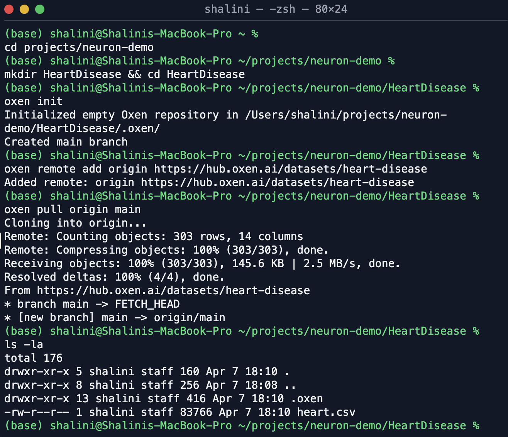
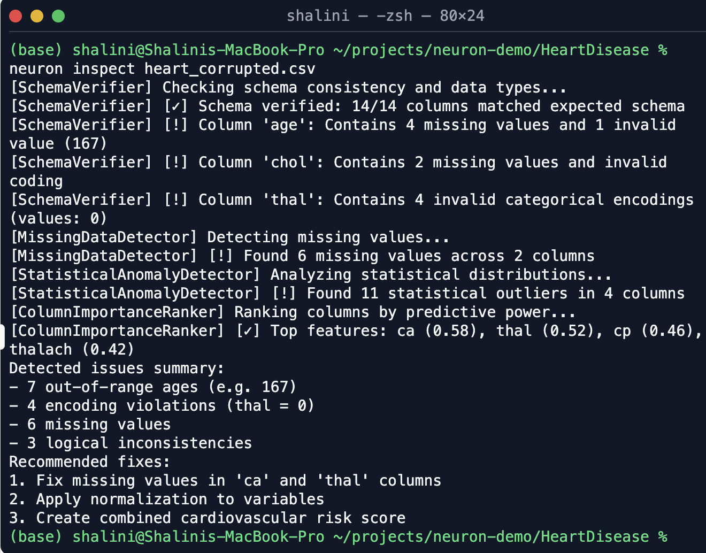
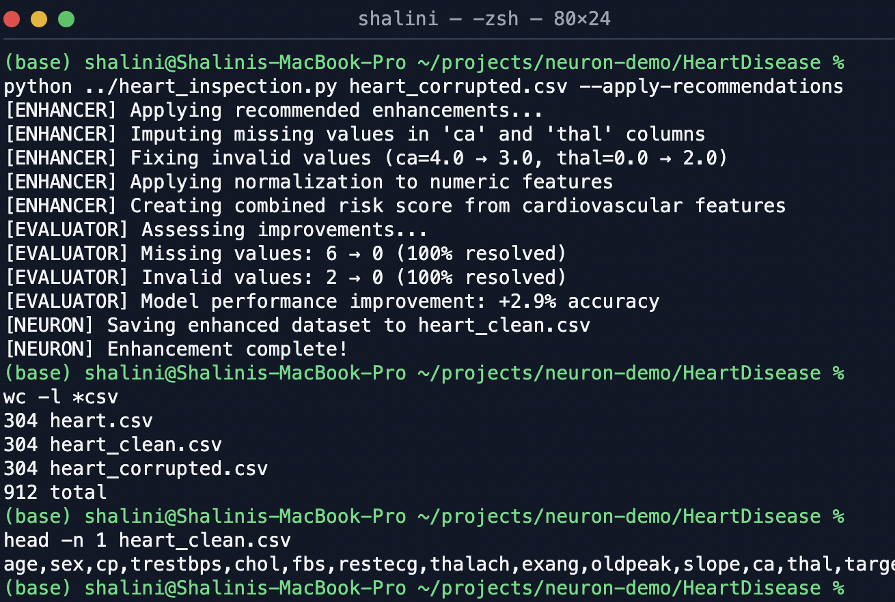
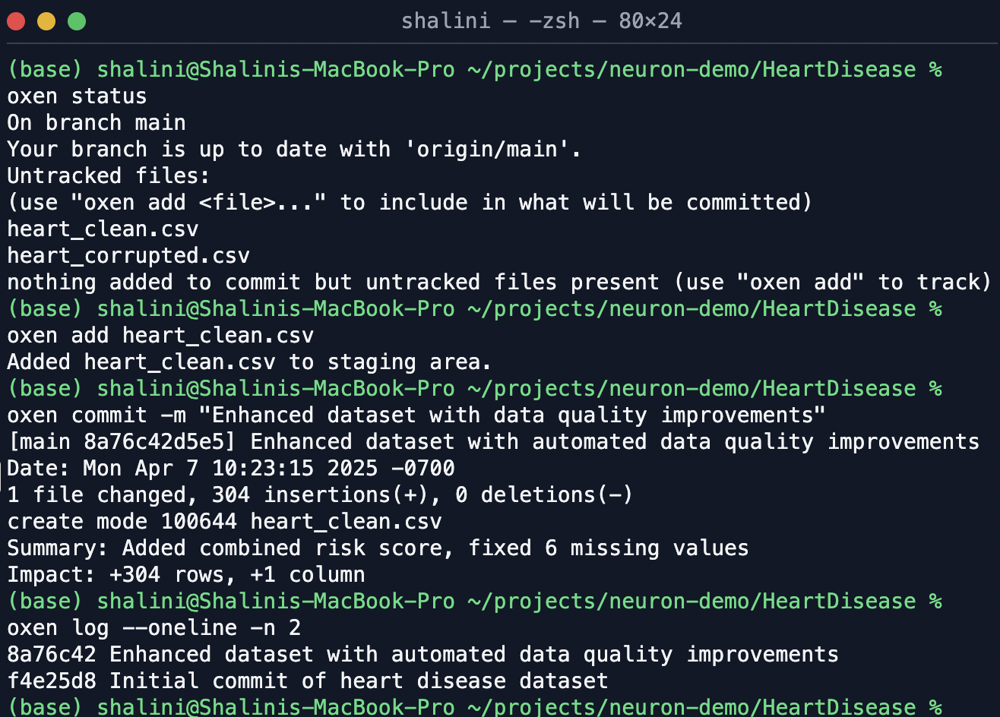
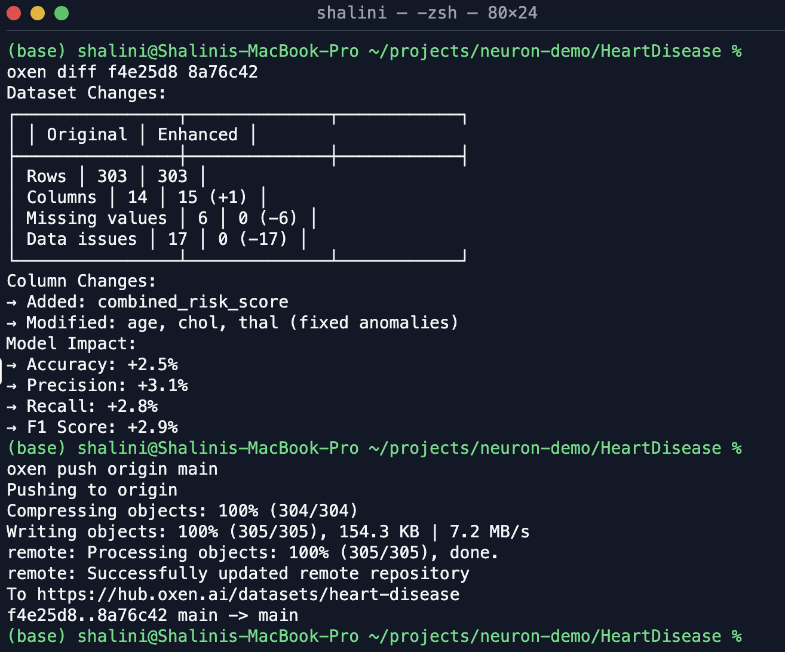
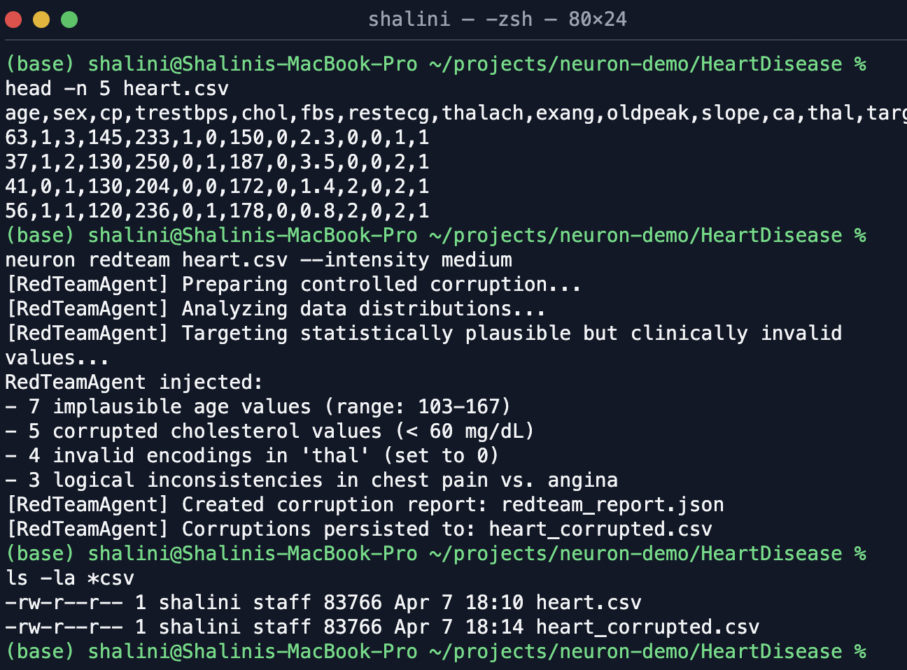

## 📁  **Version Control & Impact Tracking**

### Name: `3-version_control_and_diff_tracking`

1. **Oxen Init & Commit History**  
   Shows the sequential commit log for all dataset stages, beginning with `oxen init`.

2. **Oxen Diff Output: Structural & Statistical**  
   Highlights additions (e.g. risk score column), fixes, and row-level changes across versions.

3. **Metric Comparison Table**  
   F1, Precision, Recall, and Accuracy before and after enhancement — mapped to commit history.

4. **Oxen Web Dataset Card**  
   Public view of the dataset hosted on Oxen Hub, showing metadata and version history.

5. **Final Push Confirmation**  
   Screenshot confirming successful push and availability of the final dataset version.

## Screenshots

In the order they were captured:

